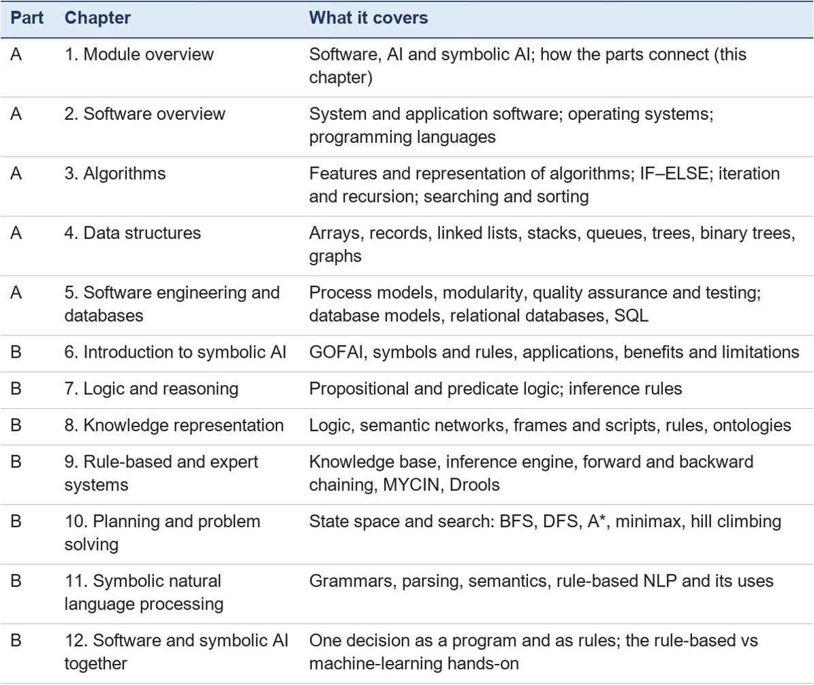
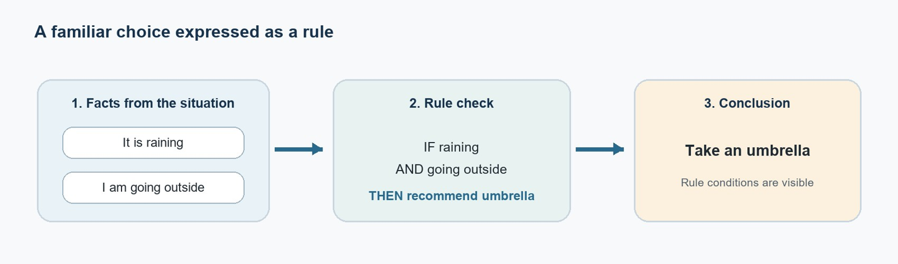
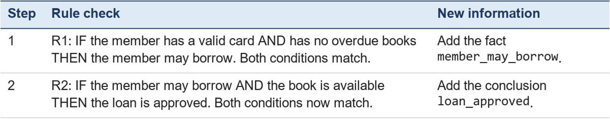
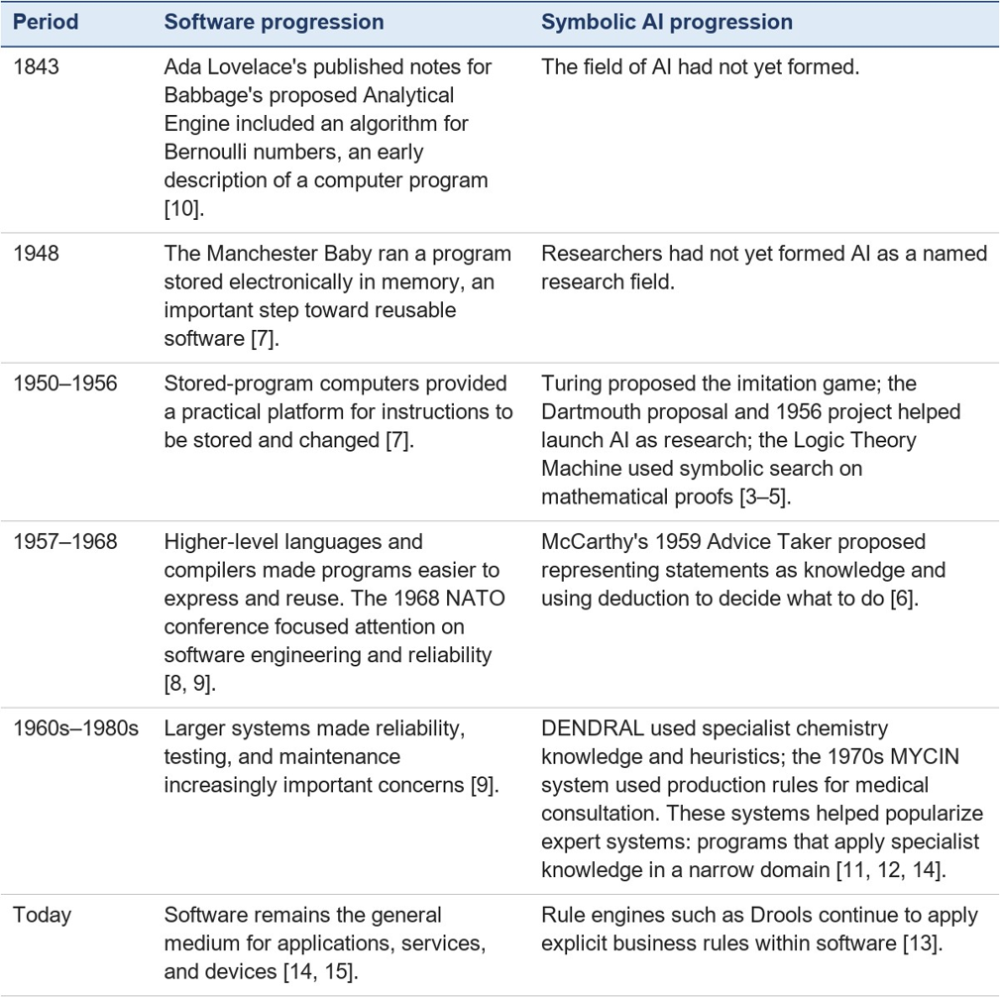

***Chapter 1 Diagrams***
---

**Figure 1. A familiar decision represented as facts, a rule, and a conclusion.**

**Figure 2. A simple architecture for symbolic AI software.**

**Figure 3 of Chapter 1**

**Figure 4 of Chapter 1**

