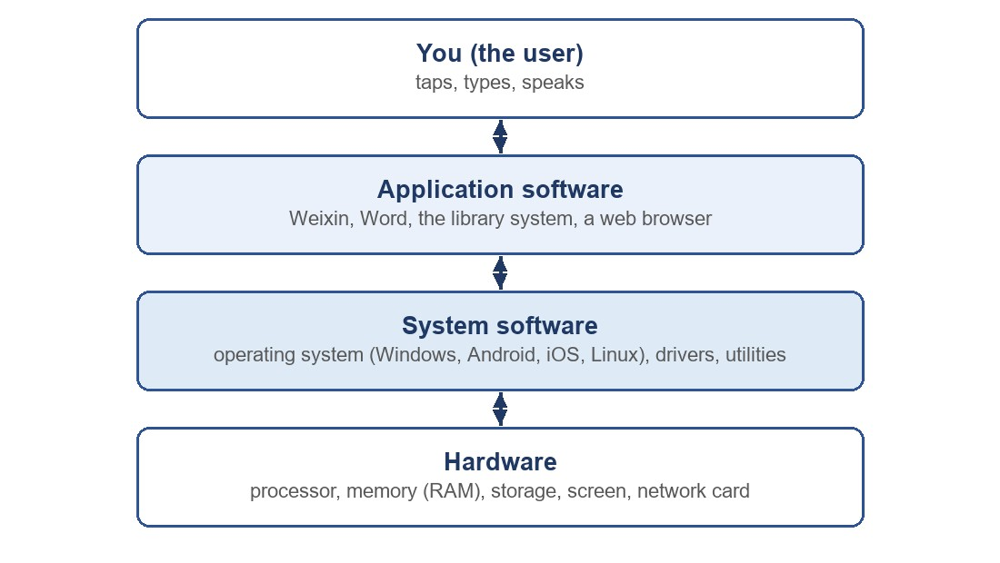
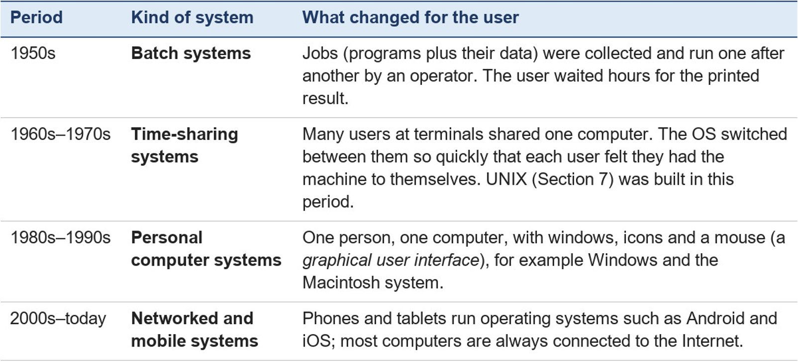
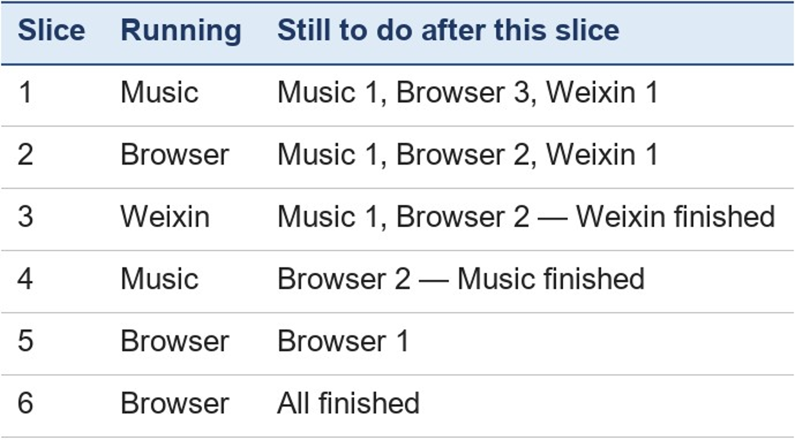
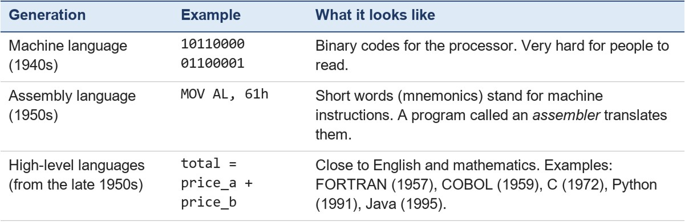
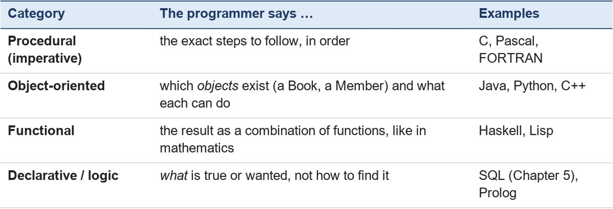

***Chapter 2 Diagrams***
---

**Figure 1. Layers of software. Each layer uses the services of the layer below it.**

**Figure 2 of Chapter 2**

**Figure 3 of Chapter 2**

**Figure 4 of Chapter 2**

**Figure 5 of Chapter 2**

**Figure 6 of Chapter 2**

