***Chapter 3 Diagrams***
---

*Figure 1 of Chapter 3*
---
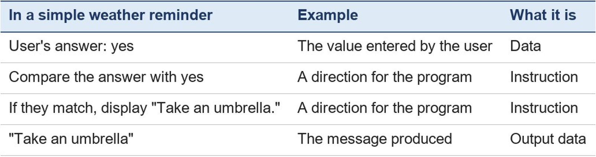

*Figure 2 of Chapter 3*
---
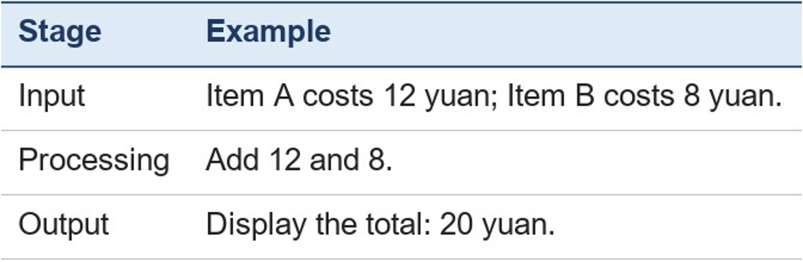

*Figure 4 of Chapter 3*
---
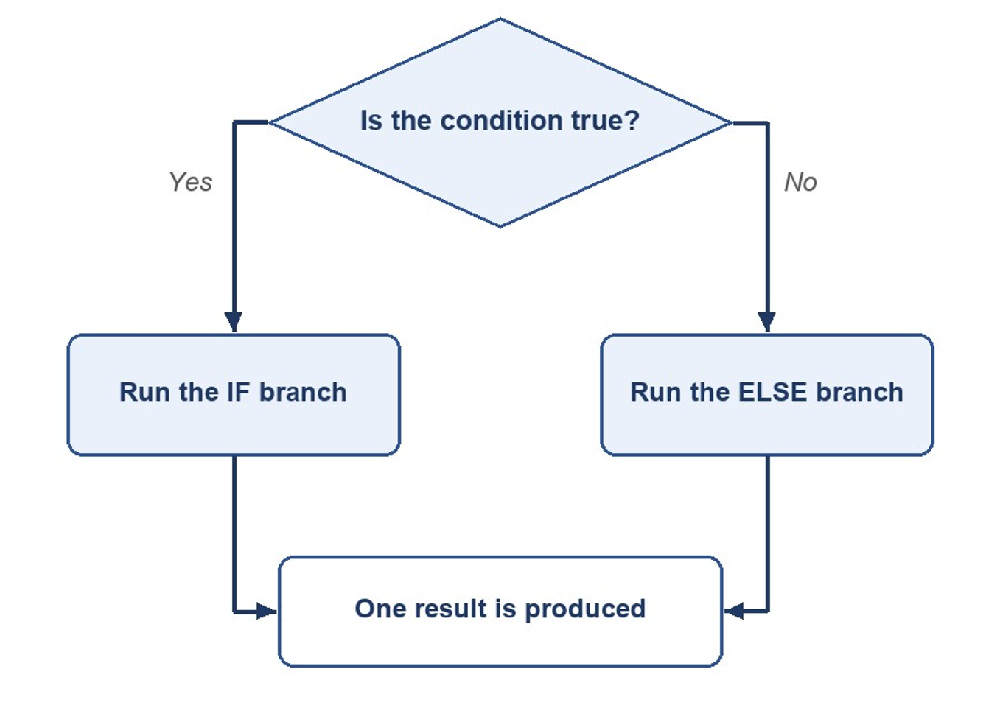

*Figure 5, The weather reminder as a flowchart: the condition is checked once, and exactly one branch runs.*
---
 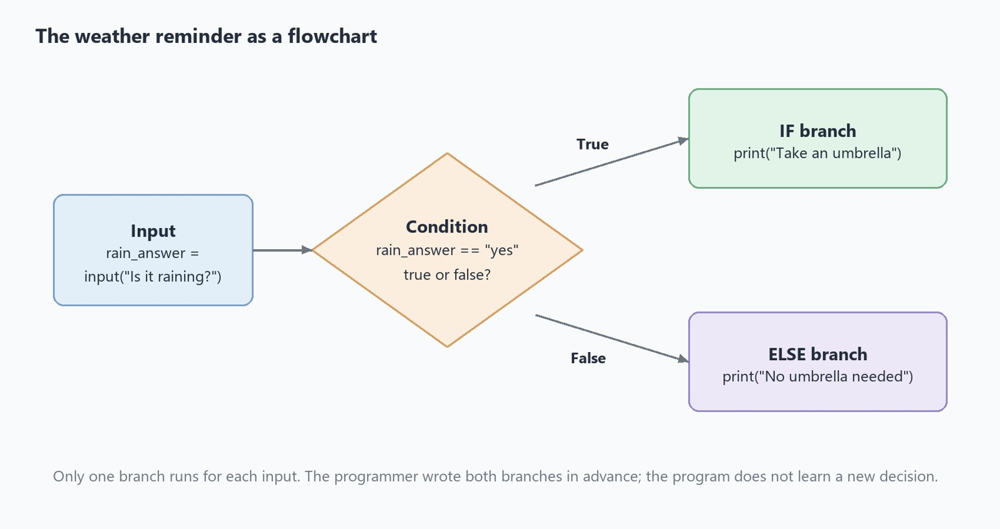

*Figure 6, The weather reminder as a flowchart: the condition is checked once, and exactly one branch runs.*
---
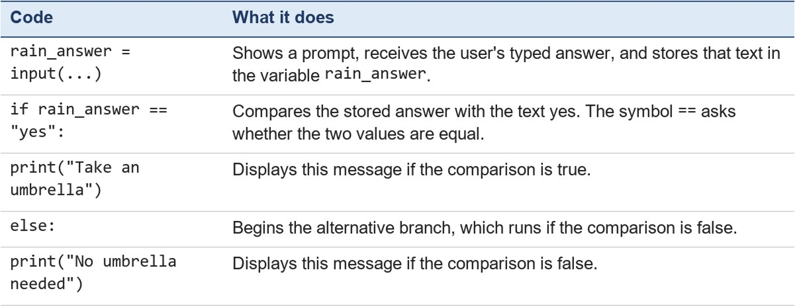

*Figure 7 of Chapter 3*
---
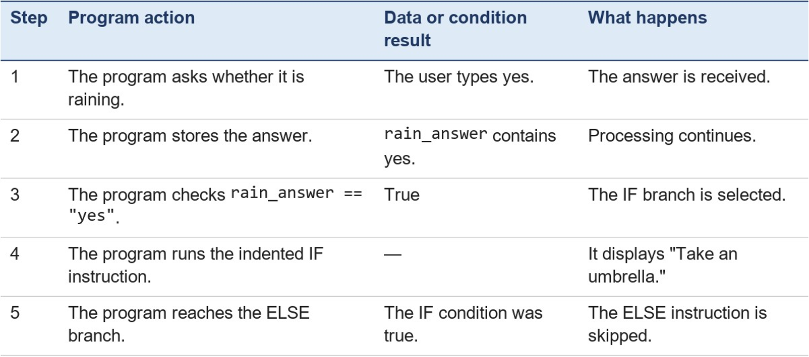

*Figure 8 of Chapter 3*
---
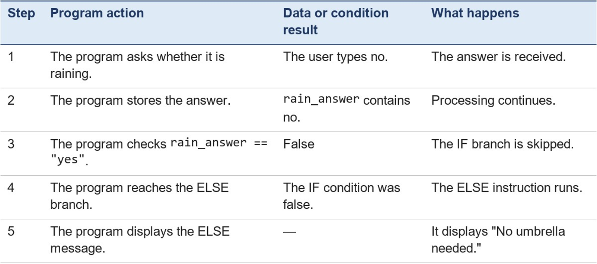

*Figure 9 of Chapter 3*
---
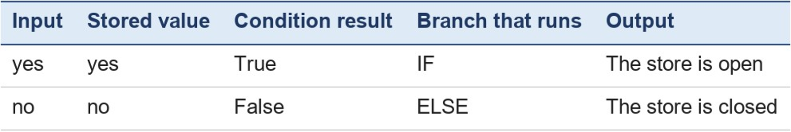

*Figure 10 Of Chapter 3*
---
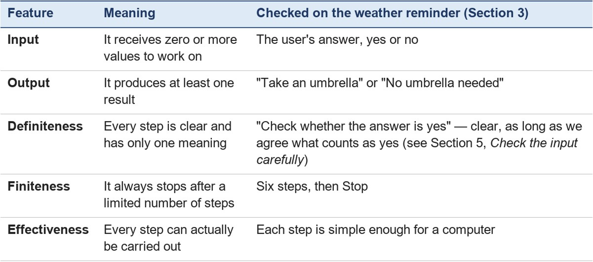

*Figure 11 of Chapter 3*
---
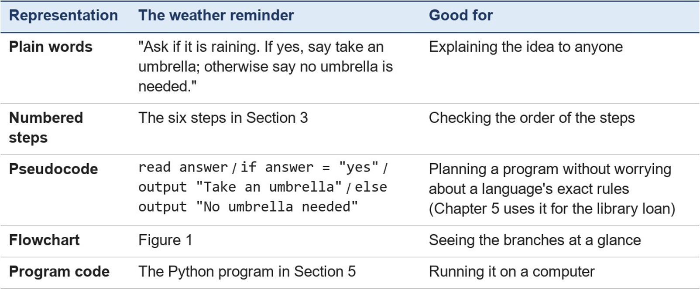

*Figure 12 of Chapter 3*
---
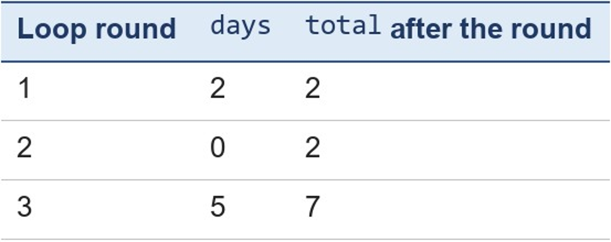

*Figure 13 of Chapter 3*
---
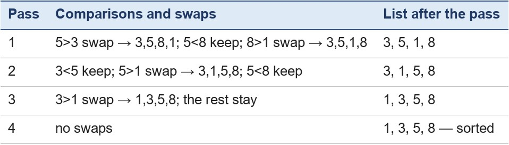

