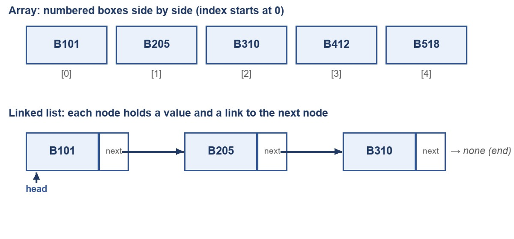
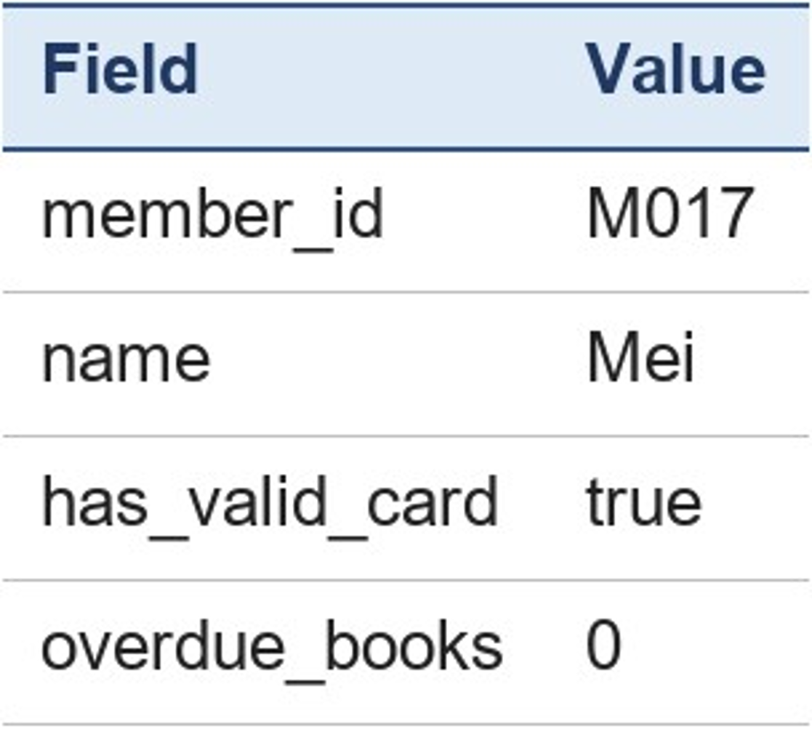
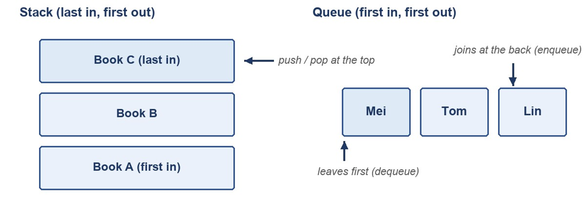
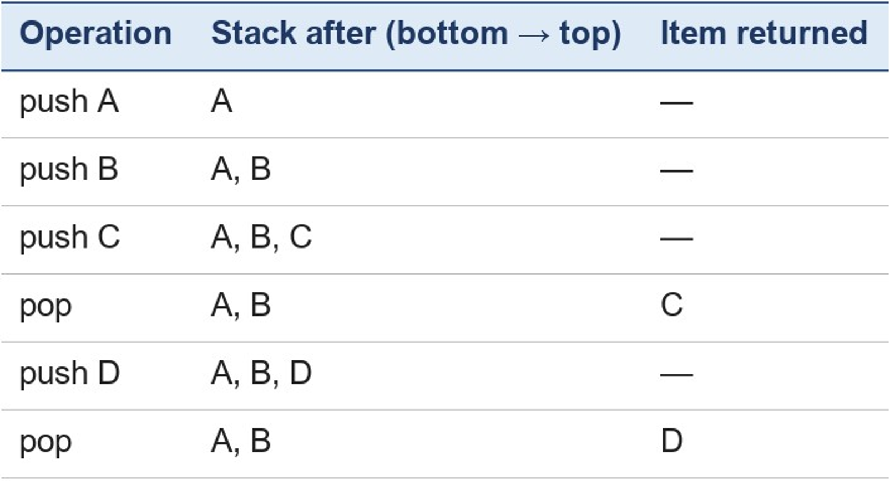
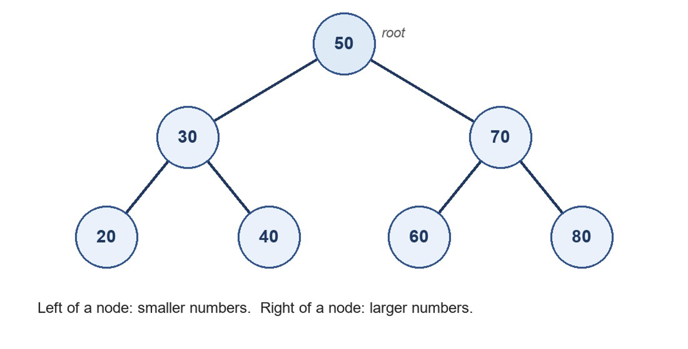
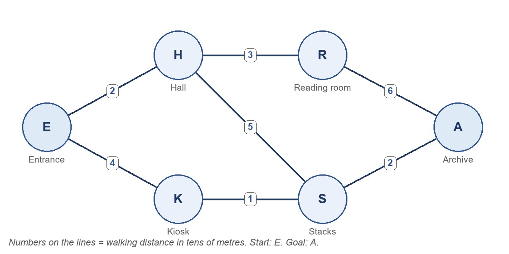
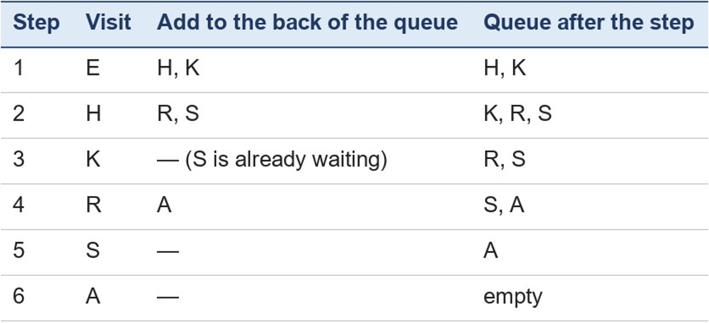
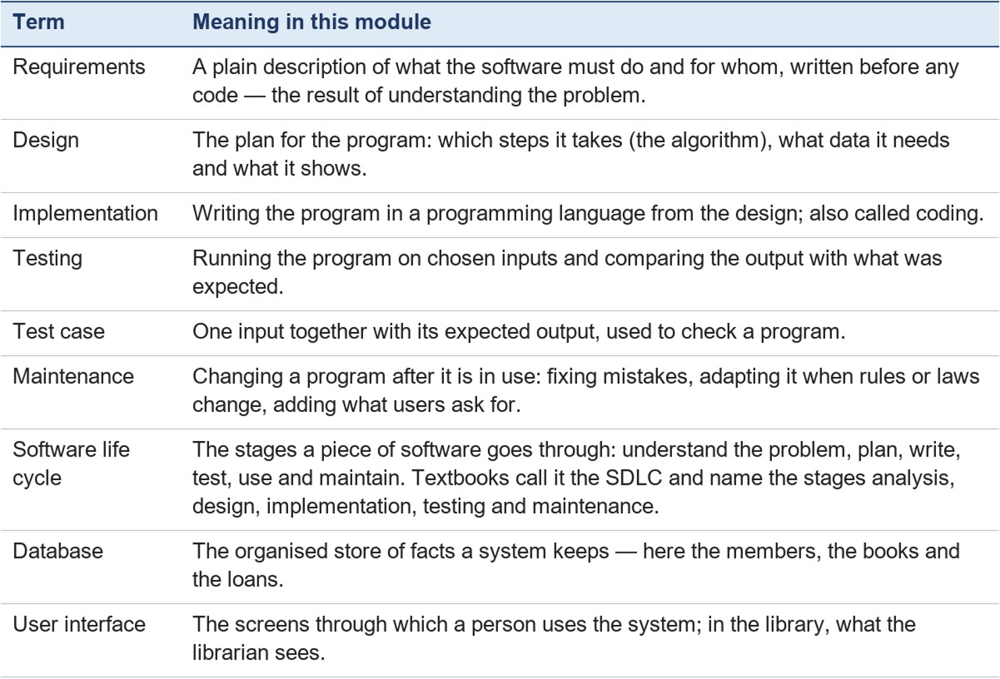

***Chapter 4 Diagrams***
---

*Figure 1. Top: an array. Bottom: a linked list.*
---

*Figure 2 of Chapter 4*
---

*Figure 3 of Chapter 4*
---

*Figure 4 of Chapter 4,  A stack (left) and a queue (right).*
---

*Figure 5 of Chapter 4, A binary search tree of shelf numbers.*
---

*Figure 6 of Chapter 4,The library map as a graph. Chapter 10 uses the numbers on the edges; here we only need which rooms are connected.*
---

*Figure 7 of Chapter 4*
---

*Figure 8 of Chapter 4*
---

