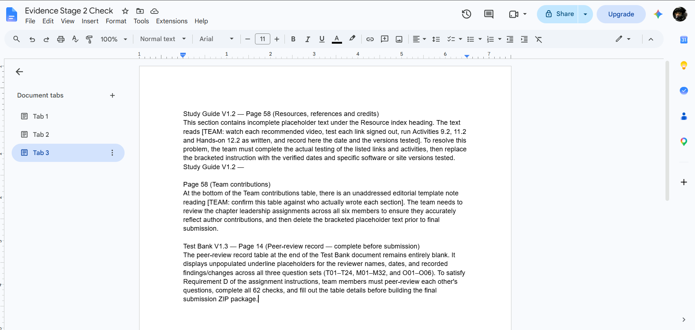
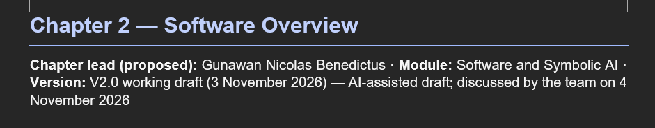
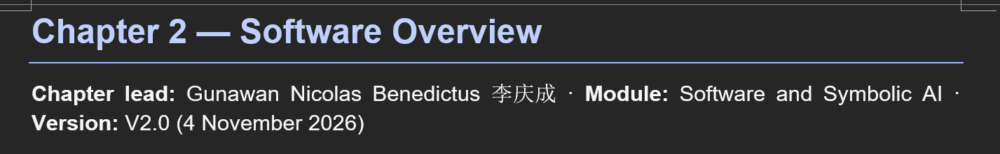
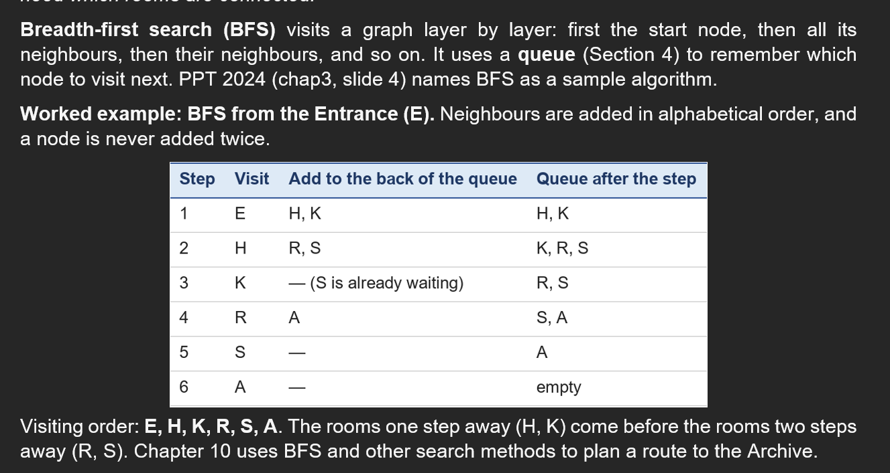
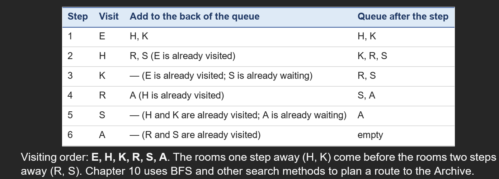
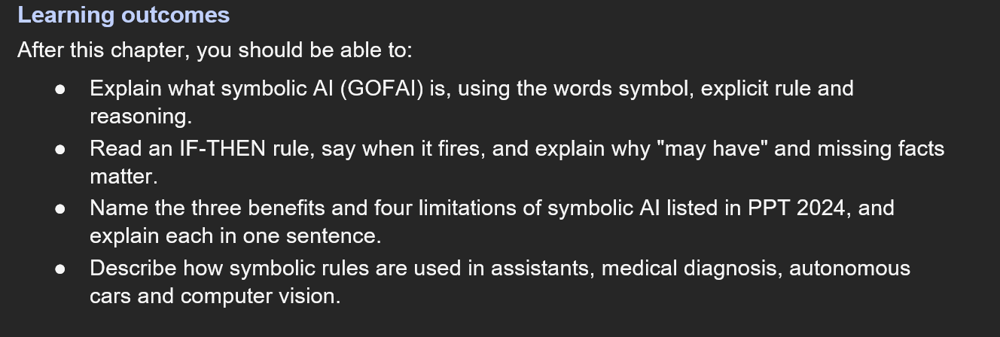
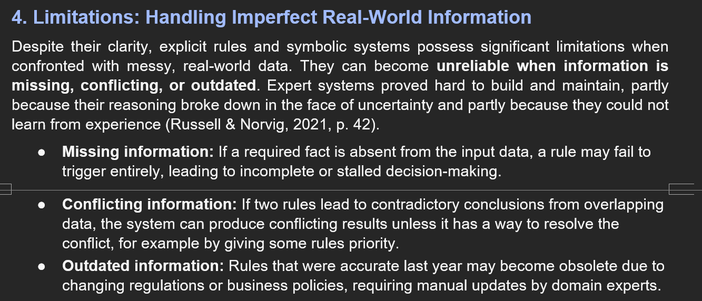
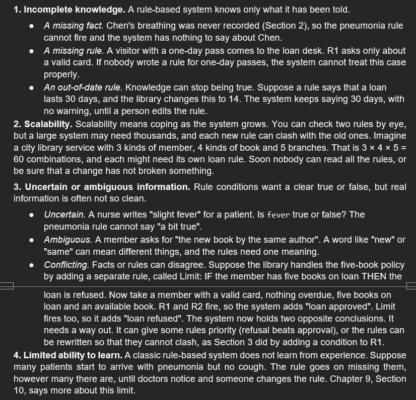

## Chapter 1-6

Chapter 2

The word "Proposed" does means its not yet finalized, even though it is.

Revised:

Chapter 4

Lacks step by step explanation about a concept. Makes it hard for the reader to understand.

Revised:

Chapter 6

The learning outcome requires learners to identify four limitations. However, only three limitations are explained in detail in this chapter.

Revised:

## Chapter 7-12 
[Evidence Stage 2 Check.docx](Evidence%20Stage%202%20Check.docx)

## Study Guide and Test Bank check
Study Guide V1.2 — Page 58 (Resources, references and credits)
This section contains incomplete placeholder text under the Resource index heading. The text reads [TEAM: watch each recommended video, test each link signed out, run Activities 9.2, 11.2 and Hands-on 12.2 as written, and record here the date and the versions tested]. To resolve this problem, the team must complete the actual testing of the listed links and activities, then replace the bracketed instruction with the verified dates and specific software or site versions tested.   Study Guide V1.2 — 

Page 58 (Team contributions)
At the bottom of the Team contributions table, there is an unaddressed editorial template note reading [TEAM: confirm this table against who actually wrote each section]. The team needs to review the chapter leadership assignments across all six members to ensure they accurately reflect author contributions, and then delete the bracketed placeholder text prior to final submission.  
 
Test Bank V1.3 — Page 14 (Peer-review record — complete before submission)
The peer-review record table at the end of the Test Bank document remains entirely blank. It displays unpopulated underline placeholders for the reviewer names, dates, and recorded findings/changes across all three question sets (T01–T24, M01–M32, and O01–O06). To satisfy Requirement D of the assignment instructions, team members must peer-review each other's questions, complete all 62 checks, and fill out the table details before building the final submission ZIP package.

